# 🤖 Tu primer agente en Copilot Studio — Manual "for dummies"

**Guía de preparación para el Applied Skills APL-6006: *Compilación de un agente en Microsoft Copilot Studio***

> 📌 **Para quién es:** personas que nunca han creado un agente ni han abierto Copilot Studio.
> 📌 **Qué vas a lograr:** entender cada tarea del examen práctico y saber exactamente qué hacer, clic por clic.
> 📌 **Versión:** examen actualizado el 13 de noviembre de 2026 (agentes con el **Microsoft Copilot harness**).

## 📥 Descarga el manual en PDF

**[⬇️ Manual_Copilot_Studio_for_Dummies_APL-6006.pdf](docs/Manual_Copilot_Studio_for_Dummies_APL-6006.pdf)** — versión ilustrada de 20 páginas, lista para imprimir o compartir.

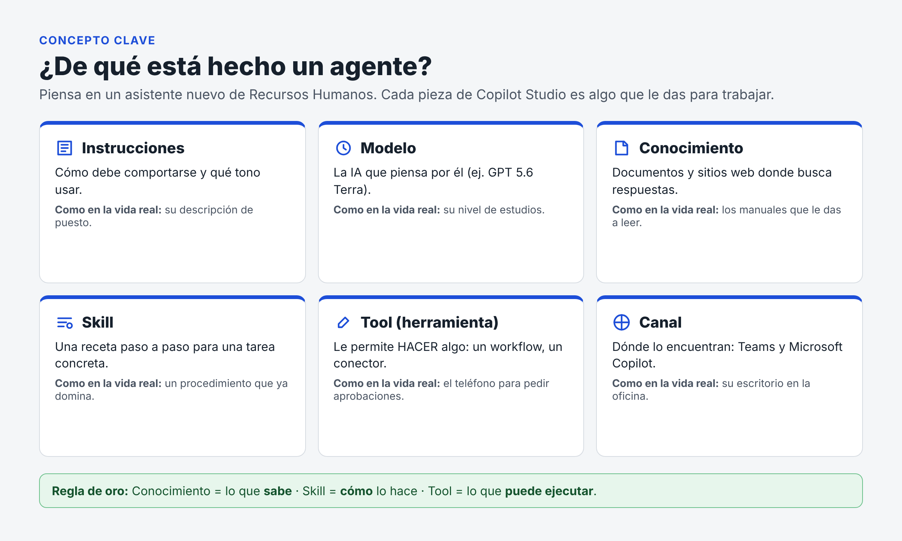

---

## Índice

1. [Cómo funciona el examen](#1-cómo-funciona-el-examen)
2. [Mini‑diccionario: 10 palabras que debes conocer](#2-mini-diccionario-10-palabras-que-debes-conocer)
3. [Antes de empezar: reglas del juego y acceso](#3-antes-de-empezar-reglas-del-juego-y-acceso)
4. [Tarea 1 — Crear el agente HRSupport](#4-tarea-1--crear-el-agente-hrsupport)
5. [Tarea 2 — Darle conocimiento, una skill y evaluarlo](#5-tarea-2--darle-conocimiento-una-skill-y-evaluarlo)
6. [Tarea 3 — Agregar un workflow con revisión humana y publicar](#6-tarea-3--agregar-un-workflow-con-revisión-humana-y-publicar) ⚠️
7. [Cierre del laboratorio](#7-cierre-del-laboratorio)
8. [¿Por qué se reprueba? Lecciones de un intento real](#8-por-qué-se-reprueba-lecciones-de-un-intento-real)
9. [Checklist final antes de terminar](#9-checklist-final-antes-de-terminar)
10. [Recursos oficiales](#10-recursos-oficiales)

---

## 1. Cómo funciona el examen

El Applied Skills **no es un examen de preguntas**: es un **laboratorio en vivo**. Te dan una máquina virtual con Windows, un buzón de correo simulado y un tenant de Microsoft 365. Cada correo es una "tarea" que tienes que resolver en Copilot Studio.

| Dato | Valor |
|---|---|
| Formato | Laboratorio práctico (hands‑on) |
| Calificación mínima | **70 %** |
| Cómo se califica | Un script revisa lo que **quedó configurado** al final, no cómo llegaste |
| Lo que más cuenta | Nombres exactos, textos exactos y que todo quede **guardado y publicado** |

**El buzón del lab** tiene 6 correos que se leen en orden:

| Hora | De | Asunto | Qué es |
|---|---|---|---|
| 9:00 | CTO | General guidelines | Reglas del examen |
| 9:15 | Network Administrator | Existing environment | Usuario y contraseña |
| 9:30 | Project Management | Create an HR support agent | **Tarea 1** |
| 10:00 | Project Management | Extend HRSupport with knowledge… | **Tarea 2** |
| 10:30 | Project Management | Create an agent workflow | **Tarea 3** |
| 11:00 | CTO | Status ‑ Complete | Fin |

> 💡 La casilla de cada correo es solo para que tú lleves el control. **No cuenta para la calificación.**

---

## 2. Mini‑diccionario: 10 palabras que debes conocer

Imagina que vas a contratar a un **asistente nuevo para Recursos Humanos**. Cada concepto de Copilot Studio tiene un equivalente en la vida real:

| Término | En palabras simples | Analogía |
|---|---|---|
| **Copilot Studio** | La herramienta web donde se crean agentes | La oficina donde entrenas al asistente |
| **Agente** | Un asistente de IA que conversa y hace tareas | El asistente nuevo |
| **Harness (Microsoft Copilot harness)** | El "motor" que hace razonar al agente | El cerebro del asistente |
| **Modelo** | La IA específica que usa el agente (ej. *GPT 5.6 Terra*) | El nivel de estudios del asistente |
| **Instrucciones** | Texto que le dice al agente cómo comportarse | Su descripción de puesto |
| **Conocimiento (Knowledge)** | Documentos o sitios web donde busca respuestas | Los manuales que le das para leer |
| **Skill** | Una habilidad específica con sus propios pasos | Un procedimiento que aprendió (ej. "cómo pedir vacaciones") |
| **Tool (herramienta)** | Algo que le permite **hacer acciones** fuera de la conversación | El teléfono o el sistema que usa para pedir aprobaciones |
| **Workflow** | Un flujo automático de pasos, tipo Power Automate | Un proceso de oficina con pasos fijos |
| **Publicar / Canal** | Hacer que el agente esté disponible para los usuarios en Teams o Copilot | Darle escritorio y teléfono para que lo encuentren |

> 🧠 **Regla de oro:** *Conocimiento* = lo que **sabe**. *Skill* = **cómo** hace algo. *Tool* = lo que **puede ejecutar**.

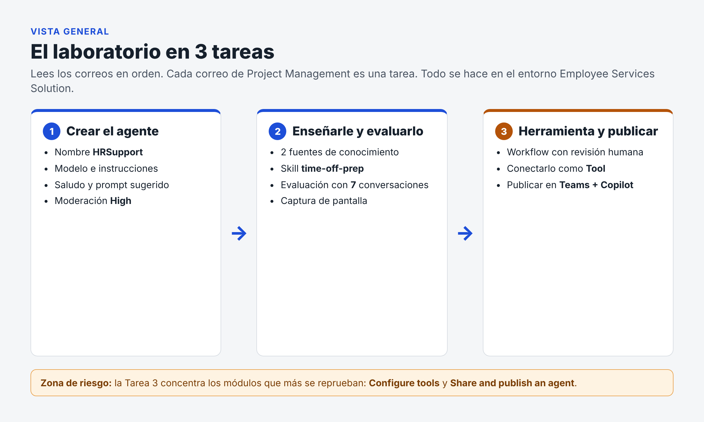

---

## 3. Antes de empezar: reglas del juego y acceso

### 3.1 Las reglas del CTO

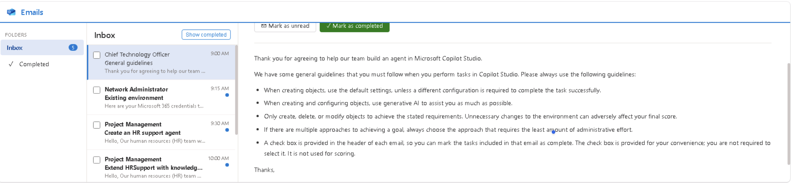

Lo que dice el correo, traducido y simplificado:

1. **Usa la configuración por defecto**, salvo que la tarea pida otra cosa.
2. **Usa la IA generativa** para ayudarte siempre que puedas.
3. **No cambies nada que no te pidan.** Cambios de más pueden **bajarte puntos**.
4. Si hay varias formas de hacer algo, elige **la que requiera menos esfuerzo**.
5. Las casillas de los correos no cuentan para la calificación.

### 3.2 Tus credenciales y el entorno

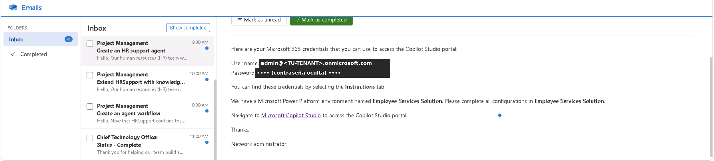

- Usuario y contraseña: los encuentras en el correo o en la pestaña **Instructions** del lab.
- **Entorno de trabajo:** `Employee Services Solution` ← **todo** se hace aquí.
- Entra a **https://copilotstudio.microsoft.com**.

> ⚠️ **Error clásico #1:** trabajar en el entorno por defecto. Arriba a la derecha de Copilot Studio aparece el selector de **Environment**: confirma que diga **Employee Services Solution** antes de crear cualquier cosa.

> 💡 **Tip de copiar/pegar:** los archivos de la tarea están en `C:\Files\`. Ábrelos con el **Bloc de notas** (doble clic), `Ctrl + A` → `Ctrl + C` y pega en Copilot Studio con `Ctrl + V`. **Nunca los escribas a mano.**

---

## 4. Tarea 1 — Crear el agente HRSupport

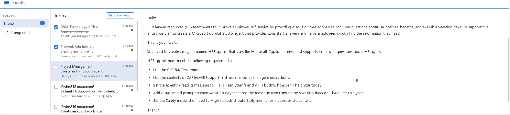

**Qué piden (en español):** crear un agente llamado **HRSupport**, con el *Microsoft Copilot harness*, que responda dudas de RR. HH.

| Requisito | Valor exacto |
|---|---|
| Nombre | `HRSupport` |
| Modelo | `GPT 5.6 Terra` |
| Instrucciones | Contenido de `C:\Files\HRSupport_Instructions.txt` |
| Mensaje de bienvenida | `Hello I am your friendly HR buddy, how can I help you today?` |
| Prompt sugerido | Nombre: `Vacation days` · Texto: `How many vacation days do I have left this year?` |
| Moderación | `High` |

### Paso a paso

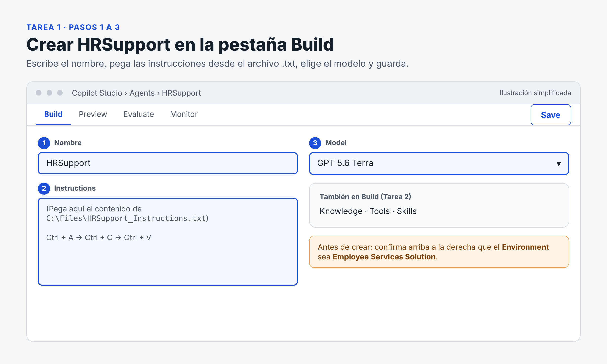

**Paso 1 — Crear el agente**
1. En Copilot Studio (entorno correcto ✅) ve a **Home** y selecciona el mosaico **Agent** (o **Agents → New agent**).
2. Se abre la pestaña **Build** con el campo de nombre activo. Escribe `HRSupport`.

**Paso 2 — Pegar las instrucciones**
1. Abre `C:\Files\HRSupport_Instructions.txt` en el Bloc de notas y copia todo.
2. Pégalo en la sección **Instructions**.
3. Clic en el ícono **Save** 💾.

**Paso 3 — Elegir el modelo**
1. En la pestaña **Build**, busca la sección **Model**.
2. Selecciona **GPT 5.6 Terra**.

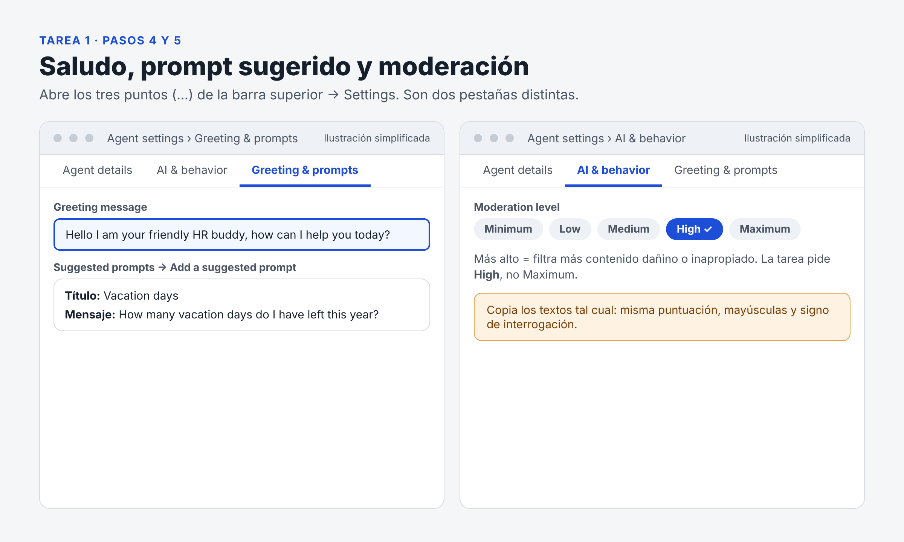

**Paso 4 — Bienvenida y prompt sugerido**
1. Clic en los **tres puntos (…)** de la barra superior → **Settings**.
2. Pestaña **Greeting & prompts**:
   - **Greeting message:** pega el saludo exacto.
   - **Add a suggested prompt** → Título `Vacation days`, mensaje `How many vacation days do I have left this year?`.

**Paso 5 — Moderación**
1. En el mismo **Settings**, pestaña **AI & behavior**.
2. **Moderation level** → **High**.
3. **Save**.

> ✅ **Verifica:** nombre sin espacios (`HRSupport`), saludo con la misma puntuación del correo, modelo correcto, moderación en *High*.

---

## 5. Tarea 2 — Darle conocimiento, una skill y evaluarlo

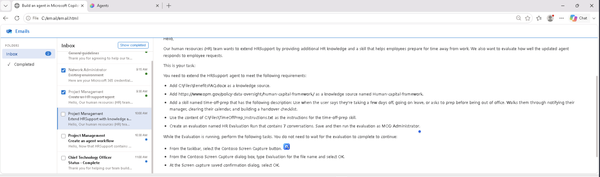

**Qué piden:** que HRSupport sepa más (2 fuentes de conocimiento), que tenga una skill para preparar ausencias, y medir qué tan bien responde.

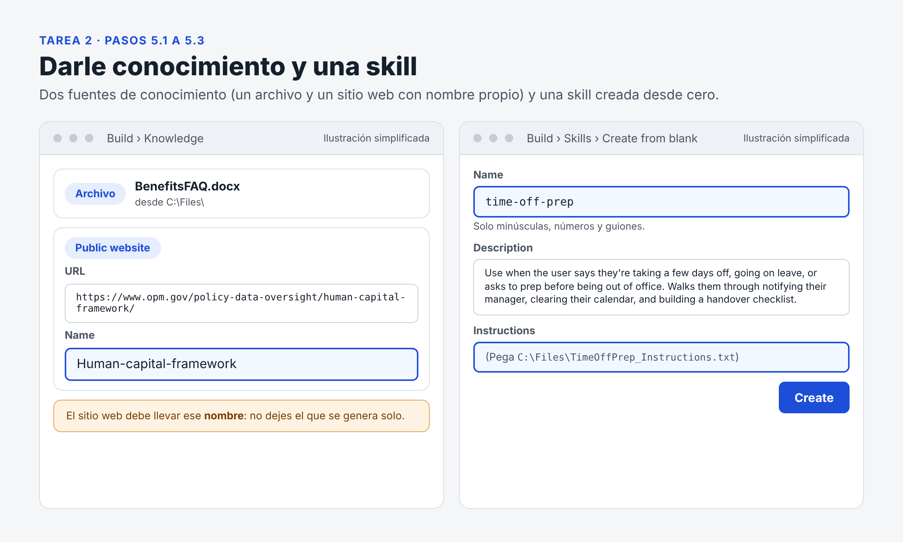

### 5.1 Conocimiento: un documento

1. Pestaña **Build** → sección **Knowledge** → **Add knowledge**.
2. Elige subir archivo y selecciona `C:\Files\BenefitsFAQ.docx`.
3. Confirma con **Add** y espera a que el estado diga que está listo.

### 5.2 Conocimiento: un sitio web

1. **Add knowledge** → **Public website**.
2. URL: `https://www.opm.gov/policy-data-oversight/human-capital-framework/`
3. **Nombre:** `Human-capital-framework` ← cámbialo, no dejes el nombre automático.
4. **Add**.

### 5.3 Crear la skill `time-off-prep`

> 🧠 Una skill es como una "receta" que el agente sigue cuando el usuario pide algo concreto (aquí: "me voy de vacaciones, ayúdame a prepararme").

1. **Build** → **Skills** → **Add skill** → **Create from blank**.
2. **Name:** `time-off-prep` (minúsculas y guiones).
3. **Description:** copia exacta del correo:
   `Use when the user says they're taking a few days off, going on leave, or asks to prep before being out of office. Walks them through notifying their manager, clearing their calendar, and building a handover checklist.`
4. **Instructions:** pega el contenido de `C:\Files\TimeOffPrep_Instructions.txt`.
5. **Create** y luego **Save** en el agente.

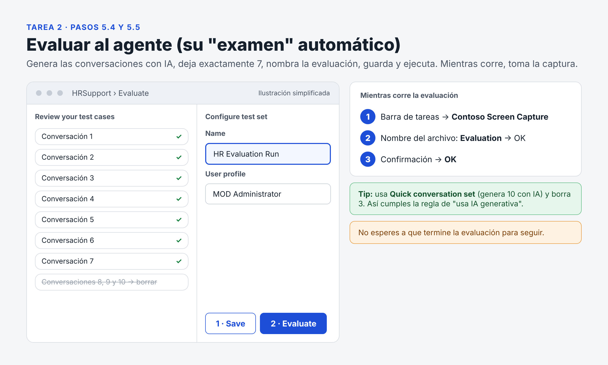

### 5.4 Evaluación `HR Evaluation Run` (7 conversaciones)

> 🧠 Evaluar = darle al agente un "examen" automático con preguntas de prueba para ver si responde bien.

1. Pestaña **Evaluate** → **New evaluation**.
2. Para cumplir el lineamiento de "usa IA generativa", selecciona **Quick conversation set** (genera 10 conversaciones con IA).
3. **Borra 3** para que queden **exactamente 7**.
4. En el panel **Configure test set**, **Name:** `HR Evaluation Run`.
5. Clic en **Save** y luego en **Evaluate**.
6. La evaluación se ejecuta con tu usuario conectado (**MOD Administrator**) — no cambies de usuario.

### 5.5 Captura de pantalla (mientras corre la evaluación)

No esperes a que termine:
1. En la barra de tareas, clic en el botón **Contoso Screen Capture**.
2. Nombre del archivo: `Evaluation` → **OK**.
3. En el mensaje de confirmación → **OK**.

> ✅ **Verifica:** 2 fuentes de conocimiento (una con nombre `Human-capital-framework`), skill `time-off-prep` creada, evaluación con **7** conversaciones guardada y ejecutada, captura `Evaluation` tomada.

---

## 6. Tarea 3 — Agregar un workflow con revisión humana y publicar

> ⚠️ **Zona de riesgo.** Estos son los dos módulos que más se reprueban: **Configure tools** y **Share and publish an agent**. Ve lento y revisa cada nombre.

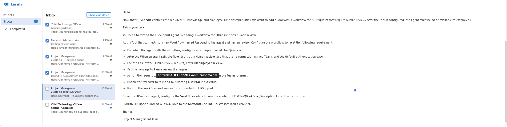

**Qué piden (en simple):** cuando un empleado haga una solicitud que necesite revisión, el agente debe enviarla a una persona que responda **Sí/No**. Después, publicar el agente para que todos lo usen en **Teams y Microsoft Copilot**.

```
 Empleado ──► HRSupport ──► [Tool] Workflow ──► Human review (Teams) ──► Sí / No ──► respuesta al agente
```

| Requisito | Valor exacto |
|---|---|
| Nombre del workflow | `Respond to the agent and human review` |
| Entrada de texto del trigger | `UserQuestion` |
| Paso de revisión humana | **Human review** con conexión llamada `Teams`, autenticación por defecto |
| Título | `HR employee review` |
| Mensaje | `Please review this request.` |
| Asignado a | `admin@<tu-tenant>.onmicrosoft.com` |
| Respuesta del revisor | Entrada **Yes/No** |
| Descripción del tool en el agente | Contenido de `C:\Files\Workflow_Description.txt` |
| Canal de publicación | **Microsoft Copilot + Microsoft Teams** |

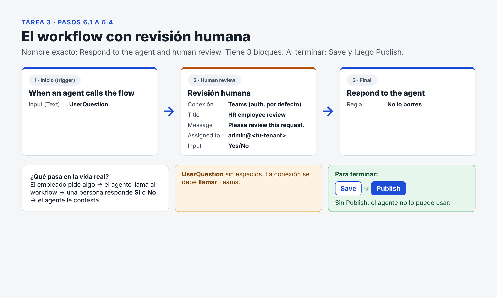

### 6.1 Crear el workflow desde el agente

1. Abre **HRSupport** → pestaña **Build** → **Tools** → **Add tool**.
2. En el diálogo **Add a tool**, clic en **Add** (junto al buscador) → **Workflow**.
3. Se abre el diseñador de workflows. Ya trae dos bloques:
   - **When an agent calls the flow** (el inicio) 
   - **Respond to the agent** (el final)
4. Cambia el nombre del workflow a: `Respond to the agent and human review`.

### 6.2 Configurar la entrada `UserQuestion`

1. Clic en el bloque **When an agent calls the flow**.
2. **Add an input** → tipo **Text**.
3. Nombre: `UserQuestion` (sin espacios, con U y Q mayúsculas).

### 6.3 Agregar la revisión humana

1. Debajo de **When an agent calls the flow**, clic en **+** (insertar paso).
2. Busca **Human review** y elige la acción de revisión/solicitud de información.
3. Si te pide una conexión: créala, **nómbrala `Teams`** y deja la **autenticación por defecto**.
4. Llena los campos:
   - **Title:** `HR employee review`
   - **Message:** `Please review this request.`
   - **Assigned to:** `admin@<tu-tenant>.onmicrosoft.com` (el mismo usuario del lab)
5. **Add an input** → tipo **Yes/No** (así el revisor responde Sí o No).

> 💡 Si el diseñador te ofrece generar o configurar el paso con Copilot, úsalo: el lineamiento pide aprovechar la IA generativa. Pero **revisa al final** que los nombres queden exactos.

### 6.4 Guardar y PUBLICAR el workflow

1. Clic en **Save** (arriba a la derecha).
2. Clic en **Publish**. ← **Si no publicas el workflow, el agente no lo puede usar.**
3. Regresa a la pestaña **Build** del agente: el workflow debe aparecer en la lista de **Tools**.

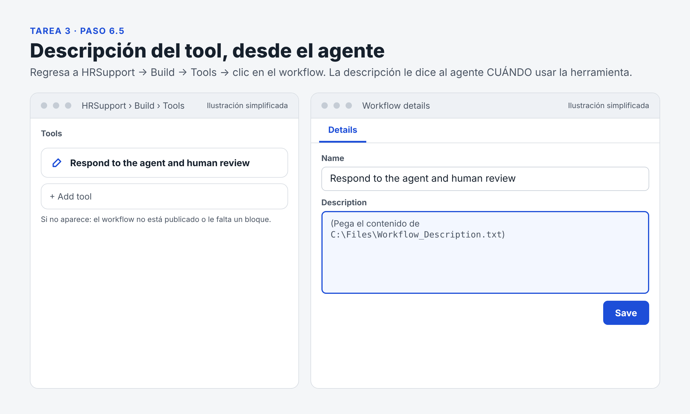

### 6.5 Descripción del tool (dentro del agente)

1. En **Build → Tools**, clic en el workflow `Respond to the agent and human review`.
2. Se abre **Workflow details**. En **Description** pega el contenido de `C:\Files\Workflow_Description.txt`.
3. **Save**.

> 🧠 ¿Por qué importa la descripción? Es lo que el agente lee para decidir **cuándo** usar esa herramienta. Sin descripción, el agente "no sabe" para qué sirve.

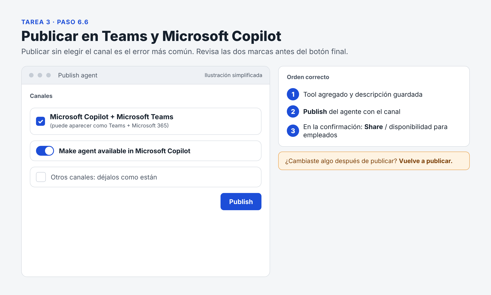

### 6.6 Publicar el agente en Teams y Microsoft Copilot

1. Arriba a la derecha del agente, clic en **Publish**.
2. En el diálogo **Publish agent**, selecciona el canal **Microsoft Copilot + Microsoft Teams** (a veces aparece como *Teams + Microsoft 365*).
3. Asegúrate de que esté activada la opción **Make agent available in Microsoft Copilot** (si no, solo queda en Teams).
4. Clic en **Publish** y espera la confirmación.
5. En la confirmación aparecen opciones para **compartir** o **agregar al catálogo de la organización**. La tarea pide que quede "disponible a los empleados": usa la opción de disponibilidad del canal que se ofrezca (p. ej. **Share** / **Availability options**) sin cambiar nada más.

> ✅ **Verifica:** workflow con nombre exacto, **publicado**, con `UserQuestion`, Human review con conexión `Teams`, título/mensaje exactos, entrada Yes/No, descripción del tool pegada, y agente **publicado en el canal de Teams + Microsoft Copilot**.

---

## 7. Cierre del laboratorio

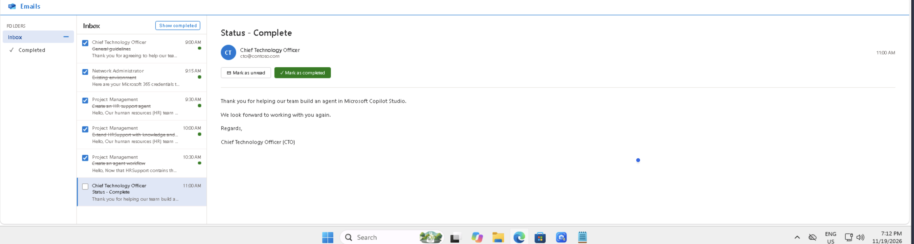

Cuando llegue el correo **Status ‑ Complete**, ya terminaste las tareas. **Antes** de dar por cerrado el lab, pasa por la [checklist final](#9-checklist-final-antes-de-terminar).

---

## 8. ¿Por qué se reprueba? Lecciones de un intento real

El examen califica por módulos. En un intento real todo salió bien excepto **Configure tools** y **Share and publish an agent**, y por eso no se alcanzó el 70 %. Ambos se resuelven en la Tarea 3.

| Módulo evaluado | Dónde se hace en este manual |
|---|---|
| Create and configure topics | Tarea 1 y 2 (skill) |
| Configure generative AI and knowledge | Tarea 1 (modelo, moderación) y 2 (conocimiento) |
| Create and configure an agent in Copilot Studio | Tarea 1 |
| **Configure tools** ⚠️ | **Tarea 3 · 6.1 a 6.5** |
| Publish the agent | Tarea 3 · 6.4 / 6.6 |
| **Share and publish an agent** ⚠️ | **Tarea 3 · 6.6** |

### Errores más comunes en "Configure tools"

| ❌ Error | ✅ Cómo evitarlo |
|---|---|
| Nombre del workflow distinto (mayúsculas, palabras de más) | Copia y pega `Respond to the agent and human review` |
| Entrada escrita `User Question` o `userquestion` | Exactamente `UserQuestion` — los espacios además causan errores en el flujo |
| La conexión se quedó con nombre automático | Renómbrala a `Teams` al crearla |
| Falta la entrada **Yes/No** del revisor | Agrégala en el paso de Human review |
| El workflow se guardó pero **no se publicó** | Siempre **Save → Publish** |
| No se pegó la descripción en **Workflow details** del agente | Es un paso aparte, se hace **desde el agente**, no desde el workflow |
| Se borró el bloque **Respond to the agent** | No lo borres: sin él el workflow no puede ser tool |

### Errores más comunes en "Share and publish an agent"

| ❌ Error | ✅ Cómo evitarlo |
|---|---|
| Se publicó el agente pero **no se seleccionó el canal** | En **Publish agent** marca **Microsoft Copilot + Microsoft Teams** |
| Quedó solo en Teams | Activa **Make agent available in Microsoft Copilot** |
| Se agregó el tool **después** de publicar y no se volvió a publicar | Cada cambio requiere **publicar de nuevo** |
| No se completó la parte de "disponible para empleados" | Revisa la pantalla de confirmación y completa la opción de compartir/disponibilidad |

---

## 9. Checklist final antes de terminar

**Entorno**
- [ ] Todo está en **Employee Services Solution**

**Tarea 1**
- [ ] Agente `HRSupport` con Microsoft Copilot harness
- [ ] Modelo `GPT 5.6 Terra`
- [ ] Instrucciones pegadas desde el `.txt`
- [ ] Saludo exacto
- [ ] Prompt sugerido `Vacation days`
- [ ] Moderación **High**

**Tarea 2**
- [ ] Conocimiento `BenefitsFAQ.docx`
- [ ] Sitio web con nombre `Human-capital-framework`
- [ ] Skill `time-off-prep` con descripción e instrucciones
- [ ] Evaluación `HR Evaluation Run` con **7** conversaciones, guardada y ejecutada
- [ ] Captura `Evaluation` tomada

**Tarea 3**
- [ ] Workflow `Respond to the agent and human review` **publicado**
- [ ] Entrada `UserQuestion` (Text)
- [ ] Human review: conexión `Teams`, título, mensaje, asignado, entrada Yes/No
- [ ] Descripción del tool pegada en **Workflow details**
- [ ] Agente **publicado** en **Microsoft Copilot + Microsoft Teams**
- [ ] Disponible para empleados (**Share**)

---

## 10. Recursos oficiales

- [Applied Skills: Compilación de un agente en Microsoft Copilot Studio](https://learn.microsoft.com/es-es/credentials/applied-skills/build-an-agent-in-microsoft-copilot-studio/)
- [Crear un agente (Microsoft Copilot harness)](https://learn.microsoft.com/microsoft-copilot-studio/agents-experience/build-new-agent)
- [Configuración del agente: saludo, prompts y moderación](https://learn.microsoft.com/microsoft-copilot-studio/agents-experience/settings-overview)
- [Crear una skill](https://learn.microsoft.com/microsoft-copilot-studio/agents-experience/skills-create)
- [Crear un test set de evaluación](https://learn.microsoft.com/microsoft-copilot-studio/agents-experience/analytics-agent-evaluation-create)
- [Agregar un workflow como tool](https://learn.microsoft.com/microsoft-copilot-studio/agents-experience/tools-add-workflow)
- [Request for information (revisión humana) en workflows](https://learn.microsoft.com/microsoft-copilot-studio/workflows-experience/flows-request-for-information)
- [Publicar un agente](https://learn.microsoft.com/microsoft-copilot-studio/agents-experience/publication-publish-agent)
- [Compartir un agente](https://learn.microsoft.com/microsoft-copilot-studio/agents-experience/authoring-share-agent)

---

> ℹ️ *Copilot Studio cambia con frecuencia; los nombres de botones pueden variar ligeramente. Los valores exactos (nombres, textos, archivos) son los del laboratorio y esos sí deben copiarse tal cual.*
> *Las capturas provienen del laboratorio oficial; las credenciales y el tenant fueron ocultados. Las ilustraciones son esquemas simplificados de la interfaz, no capturas reales.*

## 📁 Estructura del repositorio

```
.
├── README.md                 ← este manual
├── docs/
│   └── Manual_Copilot_Studio_for_Dummies_APL-6006.pdf
├── img/
│   ├── ejercicios/           ← correos del laboratorio (datos ocultos)
│   └── ilustraciones/        ← esquemas paso a paso
└── LICENSE
```

## 📝 Licencia

Contenido bajo [CC BY 4.0](LICENSE). Microsoft, Copilot Studio y Teams son marcas de Microsoft Corporation. Este manual es una guía de estudio independiente y no es material oficial de Microsoft.
